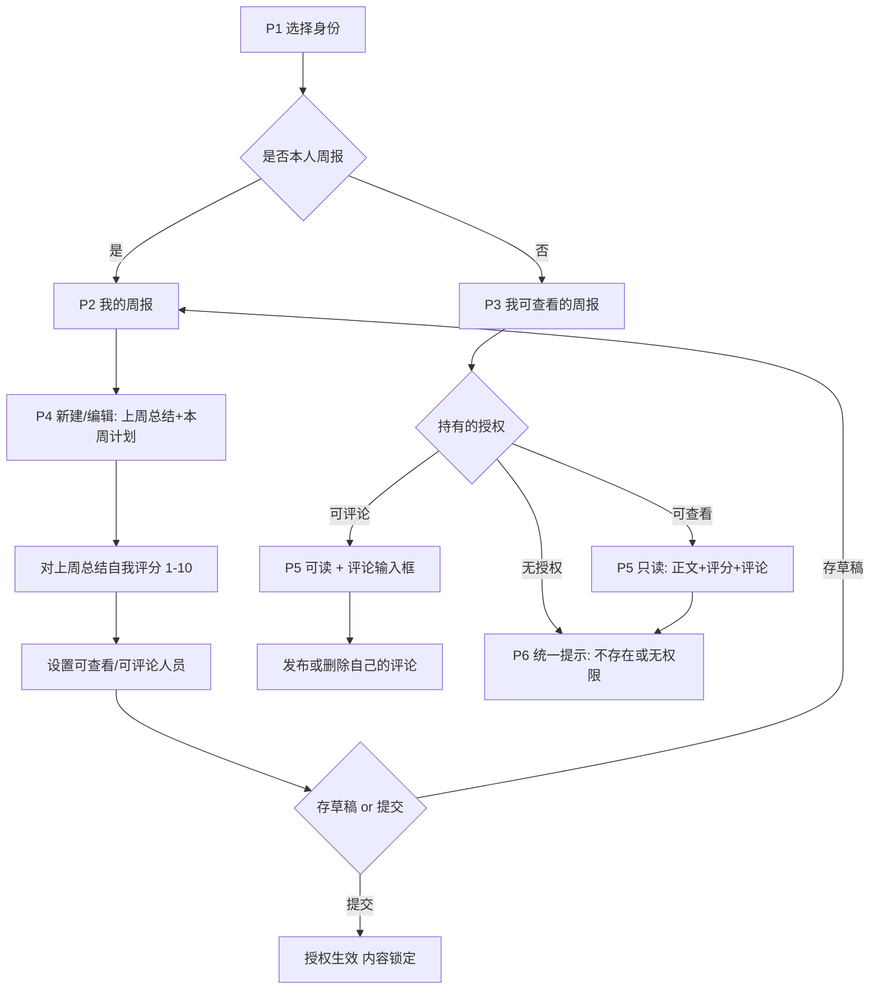

# 精简工作周报平台 — 书面设计方案（PRD v0.1）

| 项目 | 内容 |
| --- | --- |
| 文档版本 | v0.1（待评审） |
| 撰写人 | 许清楚（产品经理） |
| 形态 | 浏览器访问的**单体应用**，数据 100% 存于**本地数据库** |
| 定位 | 只做「写周报 + 自我评分 + 人级查看/评论授权 + 评论」四件事 |

---

## 1. 方案概览

**一句话定位**：一个部署在本机、通过浏览器访问的极简周报工具，让每位成员记录「上周总结 / 本周计划」并给自己打分，再由提交人逐篇指定谁能看、谁能评论。

- **目标用户**：5–30 人规模的小团队/科室，不依赖任何在线协作平台，对数据不出本机有硬要求。
- **核心价值**：① 用固定两段式结构把周报写作压到 5 分钟内；② 自我评分形成可回溯的自我复盘锚点；③ 人级白名单授权，把"谁能看我的周报"变成一次显式决策，而非默认公开。
- **三条设计原则**：不做多租户（单实例单团队）；不做组织架构（授权到人，不授权到部门）；不做社交属性（无点赞、无@、无通知）。

---

## 2. 核心功能边界

### 2.1 In Scope（本期必做）

| 编号 | 功能名 | 一句话描述 | 优先级 |
| --- | --- | --- | --- |
| F1 | 身份进入 | 用户以「选择已有成员」的方式进入系统，无需密码（形式待确认，见 Q10） | P0 |
| F2 | 周报创建与编辑 | 填写「上周总结」「本周计划」两个固定文本块，并对「上周总结」打自我评分 | P0 |
| F3 | 自我评分 | 对「上周总结」单独给出一个分值，可选填一句评分说明 | P0 |
| F4 | 权限配置 | 提交人为单篇周报分别指定「可查看人员」与「可评论人员」白名单 | P0 |
| F5 | 周报列表 | 两个视图：我的周报（我提交的）／我可查看的周报（他人授权给我的） | P0 |
| F6 | 周报详情 | 展示正文两段、评分、评论列表 | P0 |
| F7 | 评论 | 被授权评论者在该周报下发表纯文本评论 | P0 |
| F8 | 草稿与提交 | 支持先存草稿，提交后正文与评分锁定（锁定粒度待确认，见 Q6） | P1 |
| F9 | 删除 | 提交人软删除自己的周报；评论者可删除自己的评论（待确认，见 Q9/Q13） | P1 |
| F10 | 空态与越权提示 | 无内容/无权限时给出统一、不泄露存在性的提示 | P1 |

### 2.2 Out of Scope（明确不做）

| 不做项 | 为什么不做 |
| --- | --- |
| 组织架构/部门管理后台 | 授权粒度到人即可满足需求，引入部门会带来"部门可见性"这一整套新规则。 |
| 用户注册与密码体系 | 单机单团队场景下注册流程无收益；是否需要一个简单口令见 Q10。 |
| 审批流（提交→上级审批→驳回） | 需求只要求"写+评+看+评"，审批属额外的状态机与角色，会突破三角色约束。 |
| 报表统计与图表 | 评分和评论本身已够复盘，聚合统计属分析层，先验证记录习惯是否成立。 |
| 数据导出（Excel/PDF） | 与"数据不外发"的约束方向冲突，且非必要功能，见 Q11。 |
| 消息通知/邮件 | 需要外部通道，违反本地化与"不外发数据"前提。 |
| 周报模板管理 | 正文固定为两个文本块，模板能力无增量价值。 |
| 附件上传 | 需文件存储与权限联动，超出最小功能集。 |
| 全文检索 | 周报量级（几十到几百篇）用列表浏览足够，检索是过早优化。 |
| 移动端 App | 浏览器访问已覆盖移动浏览器，原生 App 属额外工程。 |
| 第三方登录 | 需外部依赖与网络回调，与本地部署冲突。 |
| 审计日志 | 本期无可追责的业务场景，保留成本高于收益（评分留痕另见 Q7）。 |
| 多语言 | 单一中文团队使用，i18n 只增加文案维护成本。 |

---

## 3. 页面范围

| 编号 | 页面 | 访问角色 | 页面目的 |
| --- | --- | --- | --- |
| P1 | 身份入口页 | 所有人（未进入身份前） | 选择"我是谁"后进入系统 |
| P2 | 我的周报（列表） | 提交人 | 管理我提交的全部周报 |
| P3 | 我可查看的周报（列表） | 查看者、评论者 | 找到他人授权给我的周报 |
| P4 | 周报编辑页（新建/编辑） | 仅提交人（本人） | 写两段正文、打分、设置权限 |
| P5 | 周报详情页 | 提交人 / 查看者 / 评论者 | 看正文与评分、读评论、写评论 |
| P6 | 无权限 / 空态页 | 任意 | 统一承载"无权访问""暂无数据"两种情形 |

**P1 身份入口页**
- 元素：成员下拉/列表（来自本地成员表）、进入按钮。
- 差异：无角色差异；未选择身份时不可访问 P2–P5 任何内容。形式（下拉 vs 输入姓名 vs 口令）见 Q10。

**P2 我的周报（列表）**
- 元素：新建周报按钮、列表（周期、状态：草稿/已提交、自我评分、可查看人数、可评论人数、评论数、更新时间）、行内操作（编辑/查看/删除）。
- 差异：仅本人可见；他人即便持有链接也不可见（包括草稿）。

**P3 我可查看的周报（列表）**
- 元素：列表（提交人、周期、评分、评论数、我的权限标签：可查看/可评论）、进入详情。
- 差异：查看者只见"可查看/可评论"两类的合集，不展示他人的权限名单；无"新建"按钮。

**P4 周报编辑页**
- 元素：周期选择（默认当周）、「上周总结」多行文本框（必填）、「本周计划」多行文本框（必填）、**自我评分**控件（紧随"上周总结"下方，视觉上从属于该块）、评分说明（选填，单行）、权限设置区（两列：可查看人员、可评论人员，均为成员多选）、按钮（存草稿 / 提交）。
- 交互提示：当「可评论人员」中包含不在「可查看人员」中的成员时，按"可评论 ⊆ 可查看"规则自动并入可查看，并给出轻提示。
- 差异：仅提交人本人可进入；已提交后按锁定策略决定字段是否只读（Q6）。

**P5 周报详情页**
- 元素：提交人 + 周期 + 状态；「上周总结」块 + 其下方评分徽标（如 8/10）+ 评分说明；「本周计划」块；权限摘要（**仅提交人可见**：谁可看、谁可评）；评论区（评论列表：作者、时间、内容；底部评论输入框）。
- 差异：
  - 提交人：可见权限摘要、删除周报、删除任意评论；不可给自己评论（或允许，见 Q15）。
  - 查看者：可见正文与评分；**不出现**评论输入框；不可见权限摘要。
  - 评论者：同查看者 + 可见评论输入框并可发布；可删除自己的评论（待确认）。

**P6 无权限 / 空态页**
- 元素：一句中性文案（如"没有找到该内容，或你没有访问权限"）+ 返回列表按钮。
- 原则：**不区分"不存在"与"无权访问"**，避免通过提示差异探测周报是否存在。

---

## 4. 数据项留存

> 仅描述实体与字段语义，不涉及表结构与实现。所有实体含 `created_at`/`updated_at` 时间戳；主键均为系统生成的不可猜测标识（非自增连续数字，减少遍历探测）。

### 4.1 成员（Member）

| 字段 | 类型 | 必填 | 说明 / 约束 |
| --- | --- | --- | --- |
| member_id | 标识 | 是 | 主键 |
| display_name | 文本(短) | 是 | 展示名；是否全局唯一见 Q2 |
| status | 枚举 | 是 | 启用 / 停用；停用后不可被选入新授权（待确认） |
| is_self | 布尔 | 是 | 是否为当前进入身份（单机场景下的兼容字段，视 Q10 结论取舍） |

### 4.2 周报（Report）

| 字段 | 类型 | 必填 | 说明 / 约束 |
| --- | --- | --- | --- |
| report_id | 标识 | 是 | 主键 |
| owner_id | 外键 → Member | 是 | 提交人；创建后不可变更 |
| week_key | 文本 | 是 | 周期标识（如 `2025-W45` 或起止日期）；是否需要"同一提交人同一周唯一"见 Q5 |
| last_week_summary | 长文本 | 是 | 「上周总结」正文，非空校验（去空白后长度 > 0） |
| this_week_plan | 长文本 | 是 | 「本周计划」正文，非空校验 |
| **self_score** | **数值（整数）** | **是** | **仅代表「上周总结」的自评，详见第 5 节** |
| self_score_note | 短文本 | 否 | 评分说明，长度上限建议 200 字 |
| status | 枚举 | 是 | 草稿 / 已提交 |
| submitted_at | 时间 | 否 | 提交时间；草稿为空 |
| is_deleted | 布尔 | 是 | 软删除标记（是否真删见 Q9） |

### 4.3 周报授权（ReportGrant）

| 字段 | 类型 | 必填 | 说明 / 约束 |
| --- | --- | --- | --- |
| grant_id | 标识 | 是 | 主键 |
| report_id | 外键 → Report | 是 | 被授权的周报 |
| member_id | 外键 → Member | 是 | 被授权人 |
| grant_type | 枚举 | 是 | 可查看(view) / 可评论(comment) |
| 唯一约束 | — | — | `(report_id, member_id, grant_type)` 唯一，重复授权幂等 |
| 约束 | — | — | 不允许 `member_id = report.owner_id`（不能授权给自己） |

> 说明：查看与评论**按两条独立记录存储**，因此"分别设置"在数据层天然成立；"可评论者是否隐含可查看"是**规则层**的事（见 R3 与 Q4），不影响存储。

### 4.4 评论（Comment）

| 字段 | 类型 | 必填 | 说明 / 约束 |
| --- | --- | --- | --- |
| comment_id | 标识 | 是 | 主键 |
| report_id | 外键 → Report | 是 | 所属周报 |
| author_id | 外键 → Member | 是 | 评论者 |
| content | 文本 | 是 | 纯文本，非空，建议上限 1000 字；不支持富文本与附件 |
| is_deleted | 布尔 | 是 | 软删除；删除后不在列表展示 |

**关系概览**：Member 1—N Report（owner）；Report 1—N ReportGrant；Member 1—N ReportGrant；Report 1—N Comment；Member 1—N Comment。

---

## 5. 评分字段与评分规则

| 项 | 规则（v0.1 建议默认值） |
| --- | --- |
| 作用对象 | **只针对「上周总结」**；「本周计划」不打分（此为硬性需求） |
| 数据形态 | 单个整数分值，存于周报记录上（一对一周报） |
| 取值范围 | **1–10 的整数**，步长 1；不允许小数 |
| 是否允许 0 分 | **不允许**（0 分语义模糊，易与"未评分"混淆） |
| 是否必填 | **必填**；未填写不允许提交 |
| 录入方式 | 推荐**滑杆（slider）+ 数字回显**，1–10 档；滑杆对"给自己打分"的心理成本最低 |
| 是否可修改 | 草稿期可任意修改；**提交后默认锁定**（如需修改见 Q7） |
| 是否留痕 | 默认不单独留存评分变更历史（若允许改分，则需决定是否留痕，见 Q7） |
| 可见性 | 所有具备"可查看"权限的人可见；评论者同样可见；未授权者不可见。**不提供"对查看者隐藏评分"的选项** |
| 标准口径 | 分值标准是否需要文字释义（如 8 = 达成主要目标），见 Q1 |

---

## 6. 权限规则

### 6.1 规则表

| 编号 | 规则 |
| --- | --- |
| R1 | 提交人可查看、编辑自己**全部**周报，含草稿。 |
| R2 | 被授予"可查看"的人，可查看该周报正文（两段）、自我评分与评分说明、评论列表。 |
| R3 | 被授予"可评论"的人，**隐含具备可查看权限**（可评论 ⊆ 可查看）；授予评论时自动补一条查看授权。 |
| R4 | 只有提交人本人可创建、编辑正文与评分；他人任何情况下不可写入。 |
| R5 | 只有提交人本人可修改该周报的授权名单；授权修改即时生效（新增可立即访问，移除立即失效）。 |
| R6 | 只有提交人本人可删除该周报（软删除）；删除后对所有人不可见。 |
| R7 | 授予评论权限不以"已提交"为前提：草稿不可被他人查看，因此草稿上的授权**不生效**，提交后才生效。 |
| R8 | 未授权者（含未进入身份者）访问周报详情：统一返回"不存在或无权限"提示，**不使用 403 与 404 区分**，不返回任何正文/标题/评分/评论数。 |
| R9 | 未授权者不出现在"我可查看的周报"列表中；列表只按授权结果过滤，不做任何"猜你喜欢"类推荐。 |
| R10 | 已提交周报的正文与评分默认锁定；权限名单是否允许继续调整见 Q6。 |
| R11 | 提交人不得把自己加入授权名单（自己天然可见）。 |
| R12 | 停用成员保留其历史周报与评论的可见性归属，但不可作为新的被授权对象。 |
| R13 | 评论者只能删除自己的评论；提交人可删除本页任意评论（是否保留见 Q13）。 |

### 6.2 角色—操作权限矩阵

| 操作 | 提交人 | 查看者 | 评论者 | 未授权用户 |
| --- | --- | --- | --- | --- |
| 查看"我的周报"列表 | 允许 | 禁止 | 禁止 | 禁止 |
| 查看"我可查看的周报"列表 | 允许（不含本人条目） | 允许 | 允许 | 禁止 |
| 新建周报 | 允许 | 禁止 | 禁止 | 禁止 |
| 查看正文两段 + 评分 | 允许 | 允许 | 允许 | 禁止 |
| 编辑正文 / 评分 | 允许（草稿，提交后默认锁定） | 禁止 | 禁止 | 禁止 |
| 修改查看/评论名单 | 允许 | 禁止 | 禁止 | 禁止 |
| 查看权限名单（谁可看/谁可评） | 允许 | 禁止 | 禁止 | 禁止 |
| 发表评论 | 禁止（默认，待确认） | 禁止 | 允许 | 禁止 |
| 删除自己的评论 | 不适用 | 不适用 | 允许 | 禁止 |
| 删除他人评论 | 允许 | 禁止 | 禁止 | 禁止 |
| 删除周报 | 允许 | 禁止 | 禁止 | 禁止 |
| 看到"周报存在"的任何痕迹 | 允许 | 允许 | 允许 | 禁止 |

---

## 7. 角色能力说明

**提交人（Owner）可做什么**
- 新建一篇周报，选好周期，填写「上周总结」与「本周计划」。
- 在「上周总结」下给自己打 1–10 分，可选填一句评分说明。
- 打开权限设置，从成员中点选"可查看人员"和"可评论人员"两张名单。
- 先存草稿离开，次日回来继续编辑；确认无误后提交。
- 在自己周报下看到"谁可看、谁可评"的摘要，随时增删名单。
- 阅读他人评论并删除不当评论；软删除整篇周报。

**查看者（Viewer）可做什么**
- 在"我可查看的周报"列表中看到该篇（显示提交人、周期、评分、评论数）。
- 打开详情，读到「上周总结」「本周计划」全文、自我评分与评分说明、全部评论。
- 看不到权限名单、看不到"编辑""删除"按钮、看不到评论输入框。

**评论者（Commenter）可做什么**
- 拥有查看者的全部能力（R3）。
- 在详情页底部输入框写下纯文本评论并发布；发布后即时出现在评论列表末尾。
- 删除自己发过的评论。

**未授权者可做什么**
- 几乎什么都不能：不进入任何列表、打不开详情、看不到标题与评分、看不到评论。
- 唯一反馈是一句中性提示"没有找到该内容，或你没有访问权限"，且不因周报是否存在而不同。

---

## 8. 关键流程

**流程一：提交人写周报并授权**
1. 进入 P1 选择身份 → 进入 P2 我的周报。
2. 点"新建"→ 进入 P4，周期默认为本周。
3. 填写「上周总结」与「本周计划」→ 在"上周总结"下拖动滑杆给出自我评分（可选填说明）。
4. 打开权限区，勾选可查看人员；勾选可评论人员（若不在查看名单内则自动并入）。
5. 点"存草稿"（可稍后继续）或"提交"→ 提交后正文与评分锁定、授权即时生效。

**流程二：查看者查看**
1. 进入 P1 选择身份 → 进入 P3，看到被授权的周报条目。
2. 点击条目 → 进入 P5，阅读两段正文、评分与评论。
3. 页面无评论输入框、无权限摘要、无编辑与删除入口；离开不影响任何数据。

**流程三：评论者评论**
1. 进入 P3，条目权限标签显示"可评论"。
2. 进入 P5，在底部输入框写评论 → 发布。
3. 评论写入本地数据库并即时展示（作者、时间、内容）；评论者删除自己的评论后列表即时更新。

---

## 9. 验收要点

| 编号 | 验收标准 |
| --- | --- |
| AC1 | 给定提交人已提交一篇周报且未授权任何人，当另一成员进入"我可查看的周报"，则列表中不出现该篇。 |
| AC2 | 给定某成员被加入"可查看人员"，当该成员打开该周报详情，则能读到两段正文完整内容与自我评分，但看不到评论输入框。 |
| AC3 | 给定某成员被加入"可评论人员"但未单独加入"可查看人员"，当保存权限设置后，则该成员既能读到正文也能发表评论（可评论⊆可查看）。 |
| AC4 | 给定某成员从未被授权，当直接访问该周报详情地址，则返回统一提示"不存在或无权限"，且响应中不含标题、正文、评分、评论数任何一项。 |
| AC5 | 给定提交人正在编辑，当"上周总结"或"本周计划"任一项为空时点提交，则提交被拒绝并提示补齐。 |
| AC6 | 给定提交人未给出自我评分，当点提交，则提交被拒绝（评分为必填）。 |
| AC7 | 给定提交人给出评分 0 或 10.5，当尝试保存，则被拒绝（仅接受 1–10 整数）。 |
| AC8 | 给定某篇已授权周报，当提交人移除某成员的查看授权并保存，则该成员再次访问立即得到统一无权限提示。 |
| AC9 | 给定查看者已登录，当浏览详情页，则页面上不出现"编辑""删除周报""权限设置"任何入口。 |
| AC10 | 给定一篇草稿周报且已填入授权名单，当被授权成员查看列表，则草稿不出现在其列表中。 |
| AC11 | 给定评论者发表一条评论，当刷新详情页，则该评论仍存在且带有正确的作者与时间（数据已落本地库）。 |
| AC12 | 给定未进入身份状态，当尝试访问 P2/P3/P5 任意页面，则被引导回 P1，不泄露任何数据。 |
| AC13 | 给定提交人软删除一篇周报，当任何人（含被授权者）访问，则得到统一提示，列表也不再出现。 |
| AC14 | 给定网络/外部服务完全不可用（断网），当完成写周报、打分、授权、评论全流程，则全部功能正常（无外部依赖）。 |

---

## 10. 待确认开放问题

| 编号 | 问题 | 为什么影响方案 | 建议默认值 | 选 A / B 的差异 |
| --- | --- | --- | --- | --- |
| Q1 | **评分取值与标准**：1–10 整数？1–5 星？百分制？是否给每档文字释义？ | 决定字段类型、控件形态、是否需要释义文案表 | 1–10 整数，滑杆录入，档位释义后置（先不做释义表） | A 1–5 星：更轻、但区分度低；B 1–10：区分度高、需释义避免各人标尺不一 |
| Q2 | **成员标识与选择方式**：预置成员表下拉选择／手工输入姓名／其他？姓名是否唯一？ | 决定是否需要一个成员维护入口，以及授权时怎么点选 | 预置成员表 + 下拉多选；姓名唯一 | A 手工输入姓名：零维护但会重名/错字，授权对象不可靠；B 预置成员表：需要一次性录入成员名单 |
| Q3 | **查看与评论人员是否分别设置** | 决定权限设置区的布局与 grant 记录条数 | 分别设置（两条独立名单），但必须满足可评论⊆可查看 | A 只设一份"可见名单"、评论默认允许：简单但失去"只看不许评"能力；B 分设：满足需求，交互多一步 |
| Q4 | **可评论者是否自动可查看** | 决定规则 R3 是否成立，以及保存时的自动补全逻辑 | 是，可评论 ⊆ 可查看，保存时自动并入 | A 是：符合直觉，无"能评论却看不到"的死角；B 否：会出现评论者看不到正文的异常态，不建议 |
| Q5 | **同一提交人在同一周是否只允许一篇周报** | 决定 week_key 是否加唯一约束，以及"新建"是否需冲突提示 | 是，唯一；同周再新建时跳转到已有篇 | A 唯一：列表干净、避免重复提交；B 允许多篇：需引入"标题"区分，正文结构会被打散 |
| Q6 | **周报是否需要"提交/锁定"状态**，提交后权限名单能否继续改 | 决定编辑页的只读逻辑与状态字段是否必要 | 需要两态（草稿/已提交）；提交后正文与评分锁定，但**权限名单仍可调整** | A 允许提交后改权限：灵活，但"已发出内容"的可见范围会变；B 一旦提交权限也锁死：可预期但纠错成本高 |
| Q7 | **评分是否允许修改，是否留痕** | 决定是否需要评分历史实体或至少一个"改分记录" | 提交后不可改；草稿可改且不留痕 | A 允许改分+留痕：需新增记录表，功能增量明显；B 提交即定分：最简单，误填只能重开一篇 |
| Q8 | **是否需要周维度切换与历史浏览**（按周筛选/翻页） | 决定列表页是否有筛选器与分页 | 需要：列表按周期倒序 + 简单"上一周/下一周"筛选 | A 只做全量倒序列表：最简单，但半年前的周报难定位；B 加周筛选：多一个筛选控件，成本低收益明确 |
| Q9 | **周报是否需要删除** | 决定 is_deleted、列表过滤与"删除"按钮是否存在 | 需要，软删除（数据保留、界面不可见） | A 不做删除：数据只增不减，误发无法撤回；B 软删除：可撤回，但对"数据留存"语义需说明 |
| Q10 | **身份如何识别**：无密码直接选人 vs 简单口令 | 决定 P1 的形态，以及"权限是否真的有效" | 无密码，从成员下拉直接选人（定位为内网/本机小团队） | A 无密码：零摩擦，但任何人都能冒充他人（权限形同约定）；B 简单口令：多一步登录与口令维护，权限才具实际约束力 |
| Q11 | **是否需要导出/打印** | 决定是否要引入导出模块 | 不做 | A 不做：符合数据不外发；B 做导出：需处理导出范围受权限约束，成本高于价值 |
| Q12 | **周报可见性默认值**：默认私有 vs 默认给某个范围 | 决定新建时权限名单的初始状态 | **默认私有**（名单为空，提交前提示"当前无人可查看"） | A 默认私有：安全，但可能大量周报无人可见；B 默认给全体成员：方便但违背"显式授权"的设计初衷 |
| Q13 | **评论是否支持删除与自己编辑** | 决定评论的软删除字段与编辑窗口 | 支持删除（自己删自己的、提交人删任意），**不支持编辑**（要改就删了重发） | A 支持编辑：需 updated_at 与"已编辑"标记；B 不支持编辑：实现最简，语义清晰 |
| Q14 | **是否需要管理员角色** | 若需要，会突破"仅三类角色"的边界 | 不需要（管理员仅在成员名单初始化时以"数据准备"方式存在，不进入产品角色） | A 需要管理员：可做成员维护与全局查看，但需定义其能否看未授权周报（会破坏 R8）；B 不需要：三角色封闭、规则可证 |
| Q15 | **提交人能否给自己的周报评论** | 影响矩阵中"发表评论"一行 | 不允许（自己的周报无需自我评论，避免与评分重复表达） | A 允许：规则更统一（评论=评论者）；B 不允许：需在详情页对 owner 隐藏输入框 |

---

*本方案不含任何代码与技术选型，仅描述功能、数据语义与规则；确认上方开放问题后将升级为 v0.2 并进入实现评审。*
