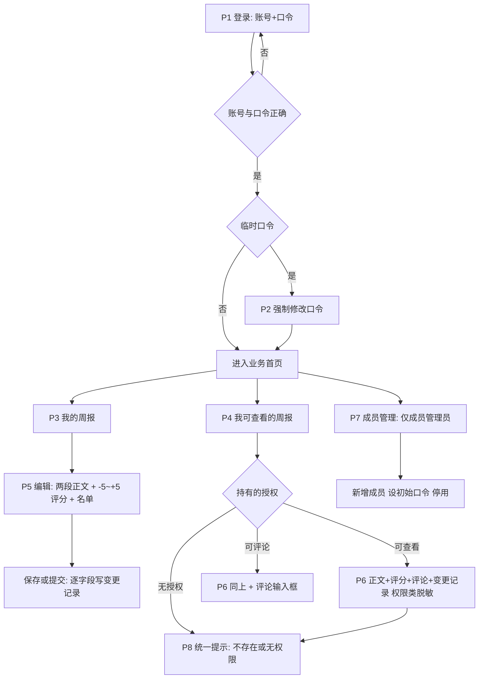

# 精简工作周报平台 — 书面设计方案（PRD v0.2）

| 项目 | 内容 |
| --- | --- |
| 文档版本 | v0.2（基于 v0.1 增量修订，v0.1 保留不动） |
| 撰写人 | 许清楚（产品经理） |
| 修订依据 | 用户已拍板 D1–D6 六项决策 |
| 形态 | 浏览器访问的**单体应用**，数据 100% 存于**本地数据库** |
| 定位 | 做「登录 + 写周报 + 自我评分 + 人级查看/评论授权 + 评论 + 变更留痕」六件事 |

---

## 变更摘要（v0.2 相对 v0.1）

| 编号 | 变更点 | 原因 |
| --- | --- | --- |
| C01 | F1「身份进入」改为「登录（账号 + 口令）」，新增 P1 登录页、P2 改口令页 | D1：取消下拉选人即进入 |
| C02 | 新增 F11「成员管理」与页面 P7，仅「成员管理员」可用 | C3：取消手输姓名后必须有新增成员的入口 |
| C03 | 新增 F9「变更记录」与 ChangeLog 实体，详情页新增变更记录区 | D5 全量留痕、D6 对所有可查看者可见 |
| C04 | 评分由 1–10 改为 **-5 ~ +5 共 11 档整数**，新增 null=未评分语义 | D3 + C1 |
| C05 | 取消「提交后锁定」；提交后正文/评分/权限均可改，每次改动留痕 | D4 |
| C06 | 「草稿/已提交」两态**保留**，但语义收窄为「对外可见性开关」，不再代表锁定 | D4 的连带判断（理由见 4.2 注） |
| C07 | 成员表新增口令哈希、角色标记、临时口令标记；删除 v0.1 的 is_self 字段 | D1、C3 |
| C08 | Out of Scope 删除「用户注册与密码体系」，改述为「不做自助注册，账号由成员管理员创建」 | D1/D2 |
| C09 | Out of Scope「审计日志」改述为「不做通用审计，仅周报变更留痕」 | D5 |
| C10 | 权限规则新增 R0 系列（登录与会话）、R14–R16（变更记录可见性与脱敏）、R17–R19（成员管理员边界） | D1/D6/C2/C3 |
| C11 | 权限矩阵新增「成员管理员」列、「查看变更记录」「查看权限明细」等行 | C2/C3 |
| C12 | 章节 7 新增「成员管理员」小节，并显式声明其为三角色边界的**唯一例外** | C3 |
| C13 | 验收要点由 14 条扩至 20 条，补登录、评分边界、脱敏、留痕、成员管理 | 上述连带 |
| C14 | 开放问题由 15 条收窄为 4 条，另设 6 条「PM 已收敛默认值」 | 用户已决策 |
| C15 | 页面编号重排为 P1–P8（登录与成员管理插入，导致后续页码顺延） | 结构完整性 |

---

## 决策台账（D1–D6 落点核对表）

| 编号 | 用户决策 | v0.2 落点章节 | 落地方式（一句话） |
| --- | --- | --- | --- |
| D1 | 每人独立口令/密码 | 2.1 F1/F2、3 P1/P2、4.1、6.3、9 AC1–AC5 | 新增登录页与改口令页；口令加盐哈希存储、最小长度 8、可自助修改、忘记口令由成员管理员重置 |
| D2 | 成员名单只保留预置成员表 | 2.1 F11、2.2、3 P7、4.1、6.1 R17/R19 | 取消手输姓名路径；所有被授权对象必须是已存在的成员账号 |
| D3 | 自我评分 -5 ~ +5 | 2.1 F4、5 全节、9 AC6–AC9 | 11 档整数、含 0、滑杆录入、可为空（空=未评分） |
| D4 | 提交后正文/评分/权限均可改，无锁定 | 2.1 F10、4.2 注、6.1 R10、9 AC10 | 取消锁定语义；保留两态仅用于控制"是否对他人可见" |
| D5 | 全量留痕（评分/正文/名单增删） | 2.1 F9、4.5、6.1 R16、9 AC11–AC13 | 新增 ChangeLog，按「字段级最小粒度」逐条记录旧值/新值/操作人/时间 |
| D6 | 留痕对所有可查看者可见 | 3 P6、6.1 R14–R16、9 AC14–AC15 | 变更记录区对所有可查看者开放；权限类记录对其脱敏（见 C2） |

---

## 1. 方案概览

**一句话定位**：一个部署在本机、通过浏览器访问、以账号口令登录的极简周报工具——成员填写「上周总结 / 本周计划」并给自己 -5~+5 的自评，由提交人逐篇指定谁能看、谁能评论，所有修改全程留痕并对可查看者透明。

- **目标用户**：5–30 人规模的小团队/科室，数据不出本机，但需要"权限真的能拦住人"（故必须有口令）。
- **核心价值**：① 固定两段式把周报写作压到 5 分钟内；② 正负分自评形成可回溯的复盘锚点；③ 人级白名单 + 口令，让"谁能看"真正具备约束力；④ 全量留痕让"改了什么"可被查看者核对，避免事后无据。
- **三条设计原则**：不做多租户（单实例单团队）；不做组织架构（授权到人）；不做社交属性（无点赞、无@、无通知）。

---

## 2. 核心功能边界

### 2.1 In Scope

| 编号 | 功能名 | 一句话描述 | 优先级 |
| --- | --- | --- | --- |
| F1 | 登录 | 以「账号 + 口令」登录；失败提示统一，不区分账号是否存在 | P0 |
| F2 | 口令管理 | 自助修改口令（需旧口令）；临时口令首次登录强制改；忘记口令由成员管理员重置 | P0 |
| F3 | 周报创建与编辑 | 填写「上周总结」「本周计划」两个固定文本块，可反复编辑保存 | P0 |
| F4 | 自我评分 | 对「上周总结」单独给 -5~+5 的整数自评，含 0，可空 | P0 |
| F5 | 权限配置 | 提交人为单篇周报分别指定「可查看人员」「可评论人员」白名单 | P0 |
| F6 | 周报列表 | 双视图：我的周报（我提交的）／我可查看的周报（授权给我的） | P0 |
| F7 | 周报详情 | 展示两段正文、评分、评论列表、变更记录 | P0 |
| F8 | 评论 | 被授权评论者发表纯文本评论 | P0 |
| F9 | 变更记录 | 正文/评分/名单每次变更自动写一条记录，并对可查看者展示（权限类脱敏） | P0 |
| F10 | 草稿与提交 | 「未提交」仅本人可见；提交后对已授权者可见；两态均不锁定 | P0 |
| F11 | 成员管理 | 成员管理员新增成员、设初始口令、重置口令、停用/启用成员 | P0 |
| F12 | 软删除 | 提交人软删除自己的周报；评论者可删除自己的评论 | P1 |
| F13 | 空态与统一越权提示 | 无权限与不存在返回同一提示 | P1 |
| F14 | 登录保护 | 连续失败冷却、会话超时失效 | P1 |

### 2.2 Out of Scope

| 不做项 | 为什么不做 |
| --- | --- |
| 自助注册 | D2 决定账号由成员管理员创建；开放自助注册等于放弃"成员表即权威名单"这一前提。 |
| 忘记口令的自助找回（邮件/短信/密保） | 需要外部通道，违反本地化与不外发前提；改由成员管理员重置。 |
| 组织架构/部门管理后台 | 授权粒度到人即可满足需求，部门可见性会引入一整套新规则。 |
| 审批流（提交→审批→驳回） | 需求只要求"写+评+看+评"，审批是额外的状态机与角色，会突破角色边界。 |
| 通用审计日志 | 只做"周报变更留痕"（D5），不做覆盖全系统的操作审计——没有可追责场景，成本高于收益。 |
| 报表统计与图表 | 评分与评论已够复盘，聚合统计属分析层，先验证记录习惯是否成立。 |
| 数据导出（Excel/PDF） | 与"数据不外发"方向冲突，且非必要功能。 |
| 消息通知/邮件 | 需外部通道，违反本地化前提。 |
| 周报模板管理 | 正文固定为两个文本块，模板无增量价值。 |
| 附件上传 | 需文件存储与权限联动，超出最小功能集。 |
| 全文检索 | 周报量级（几十到几百篇）用列表浏览足够，检索是过早优化。 |
| 移动端 App | 浏览器访问已覆盖移动浏览器。 |
| 第三方登录 | 需外部依赖与网络回调，与本地部署冲突。 |
| 多语言 | 单一中文团队使用，i18n 只增加文案维护成本。 |
| 成员删除 | 会破坏历史周报与评论的归属完整性；只允许停用。 |

---

## 3. 页面范围

| 编号 | 页面 | 访问角色 | 页面目的 |
| --- | --- | --- | --- |
| P1 | 登录页 | 未登录者 | 账号 + 口令进入系统 |
| P2 | 口令修改页 | 已登录成员 | 自助改口令；临时口令首次登录强制经过此页 |
| P3 | 我的周报（列表） | 提交人 | 管理我提交的全部周报 |
| P4 | 我可查看的周报（列表） | 查看者、评论者 | 找到他人授权给我的周报 |
| P5 | 周报编辑页 | 仅本人 | 写两段正文、打分、设置权限 |
| P6 | 周报详情页 | 提交人 / 查看者 / 评论者 | 看正文、评分、评论、变更记录 |
| P7 | 成员管理页 | 仅成员管理员 | 新增/停用成员、重置口令 |
| P8 | 无权限 / 空态页 | 任意 | 统一承载"无权访问""暂无数据" |

**P1 登录页**：账号输入、口令输入、登录按钮。失败提示恒为「账号或口令不正确」（不区分账号是否存在）。无"注册"入口；忘记口令处给一句静态说明"请联系成员管理员重置"。登录成功后按角色分流到 P3；带临时口令的账号强制进 P2。

**P2 口令修改页**：旧口令、新口令、确认新口令。强制改密态下不提供"稍后再说"，未改完不得进入业务页面。新口令规则见 6.3。

**P3 我的周报（列表）**：新建周报按钮；列表列（周期、状态：未提交/已提交、自我评分、可查看人数、可评论人数、评论数、最后修改时间）；行内操作（编辑/查看/删除）。仅本人可见，他人即便持有链接也不可见（含未提交稿）。

**P4 我可查看的周报（列表）**：列表列（提交人、周期、评分、评论数、最近变更时间、我的权限标签：可查看/可评论）；无新建按钮；不展示任何人的权限名单。

**P5 周报编辑页**：
- 元素：周期选择（默认当周）、「上周总结」多行文本框（必填）、**自我评分滑杆**（紧随「上周总结」下方，视觉上从属于该块；控件旁显示"当前档位释义"）、评分说明（选填，≤200 字）、「本周计划」多行文本框（必填）、权限设置区（两列：可查看人员、可评论人员，均为成员多选）、按钮（保存 / 提交）。
- 交互：拖动滑杆时实时显示"当前值 + 该档释义"（如 `+2 超出预期`）；未拖动时显示「未评分」。
- 不设只读态：已提交周报仍进入本页编辑（D4），页面顶部提示"本次保存将生成一条变更记录"。
- 权限区可选成员来自成员表中启用状态的账号（D2，无手输路径）。

**P6 周报详情页**：
- 元素：提交人 + 周期 + 状态 + 最后修改时间；「上周总结」块 + 其下方评分徽标（`+3` / `0` / `-2`）+ 评分说明；「本周计划」块；**变更记录区**；评论区（列表 + 输入框）。
- 差异：
  - 提交人：可见权限摘要（谁可看、谁可评）与变更记录**完整明细**（含人名与增删方向）；可见删除周报、删除任意评论；不出现评论输入框。
  - 查看者：可见正文、评分、评论区；可见变更记录，但**权限类记录渲染为中性文案**（"查看名单已调整""评论名单已调整"，不含人名、不含方向、不含人数）；不可见权限摘要；无评论输入框、无编辑/删除入口。
  - 评论者：同查看者 + 可见评论输入框，可发布与删除自己的评论。

**P7 成员管理页**（仅成员管理员）：成员列表（姓名、角色标记、状态、最后登录时间）；操作（新增成员并设初始口令、重置口令、停用/启用）。不可删除成员；不可停用自己的账号；**不提供任何周报浏览入口**。

**P8 无权限 / 空态页**：一句中性文案「没有找到该内容，或你没有访问权限」+ 返回列表。原则：**不区分"不存在"与"无权访问"**。

---

## 4. 数据项留存

> 只描述实体与字段语义，不涉及表结构与实现。所有实体含 created_at / updated_at；主键为系统生成的不可猜测标识。

### 4.1 成员（Member）

| 字段 | 类型 | 必填 | 说明 / 约束 |
| --- | --- | --- | --- |
| member_id | 标识 | 是 | 主键 |
| display_name | 文本(短) | 是 | 展示名，全局唯一（同团队不允许重名，否则授权对象不可辨） |
| password_hash | 文本 | 是 | **口令的加盐哈希值，不可逆；系统内不存在任何明文口令字段** |
| password_updated_at | 时间 | 是 | 口令最后修改时间 |
| must_change_password | 布尔 | 是 | 为真时（管理员重置后的临时口令）登录后强制进 P2 |
| role_flag | 枚举 | 是 | 普通成员 / 成员管理员（后者是对三角色的唯一例外，见 6.1 R17） |
| status | 枚举 | 是 | 启用 / 停用；停用后不可登录、不可作为新授权对象 |
| last_login_at | 时间 | 否 | 最后成功登录时间（成员管理页可见，便于识别僵尸账号） |

### 4.2 周报（Report）

| 字段 | 类型 | 必填 | 说明 / 约束 |
| --- | --- | --- | --- |
| report_id | 标识 | 是 | 主键 |
| owner_id | 外键 → Member | 是 | 提交人；创建后不可变更 |
| week_key | 文本 | 是 | 周期标识（如 `2025-W45`）；是否"同一人同一周唯一"见 Q1 |
| last_week_summary | 长文本 | 是 | 「上周总结」正文；提交时非空（去空白长度 > 0） |
| this_week_plan | 长文本 | 是 | 「本周计划」正文；提交时非空 |
| **self_score** | **整数，可为空** | **提交时是** | **仅代表「上周总结」的自评；取值范围 -5 ~ +5；空值 = 未评分** |
| self_score_note | 短文本 | 否 | 评分说明，≤200 字 |
| status | 枚举 | 是 | 未提交 / 已提交 |
| submitted_at | 时间 | 否 | **首次**提交时间；后续修改不改写此字段（修改时间由变更记录体现） |
| is_deleted | 布尔 | 是 | 软删除标记 |

> **注（C06 的理由）**：D4 取消了"提交后锁定"，但两态**必须保留**——因为「授权是否生效」需要一个开关（R7）。若无此态，未写完的半成品一填进名单就对他人可见。故 v0.2 中两态只回答一个问题：**这篇周报对他人是否可见**（未提交=仅本人可见；已提交=按名单可见），它**不再**回答"能否修改"（任何状态下都能改）。

### 4.3 周报授权（ReportGrant）

| 字段 | 类型 | 必填 | 说明 / 约束 |
| --- | --- | --- | --- |
| grant_id | 标识 | 是 | 主键 |
| report_id | 外键 → Report | 是 | 被授权的周报 |
| member_id | 外键 → Member | 是 | 被授权人（必须是已存在的启用成员） |
| grant_type | 枚举 | 是 | 可查看(view) / 可评论(comment) |
| 唯一约束 | — | — | `(report_id, member_id, grant_type)` 唯一，重复授权幂等 |
| 约束 | — | — | 不允许 `member_id = report.owner_id` |

> 本实体只存**当前**名单；名单的每一次增删不在此处留历史，而是写入 4.5 变更记录。查看与评论按两条独立记录存储，故"分别设置"在数据层天然成立。

### 4.4 评论（Comment）

| 字段 | 类型 | 必填 | 说明 / 约束 |
| --- | --- | --- | --- |
| comment_id | 标识 | 是 | 主键 |
| report_id | 外键 → Report | 是 | 所属周报 |
| author_id | 外键 → Member | 是 | 评论者 |
| content | 文本 | 是 | 纯文本，非空，≤1000 字；不支持富文本与附件 |
| is_deleted | 布尔 | 是 | 软删除 |

### 4.5 变更记录（ChangeLog）

| 字段 | 类型 | 必填 | 说明 / 约束 |
| --- | --- | --- | --- |
| change_id | 标识 | 是 | 主键 |
| report_id | 外键 → Report | 是 | 目标周报 |
| operator_id | 外键 → Member | 是 | 操作人（当前恒为提交人，字段仍显式保留以备扩展） |
| change_type | 枚举 | 是 | 正文 / 评分 / 权限 |
| field_name | 枚举 | 是 | `last_week_summary` / `this_week_plan` / `self_score` / `self_score_note` / `grant_view` / `grant_comment` |
| old_value | 长文本 | 否 | 变更前的值；新建时为空 |
| new_value | 长文本 | 否 | 变更后的值 |
| is_truncated | 布尔 | 是 | 旧/新值是否因超长被截断 |
| changed_at | 时间 | 是 | 变更时间；同一次保存的多字段变更共享同一时间戳 |

**三条落库规则**：
1. **最小粒度**：一条记录只描述一个字段的一次变更；一次保存改动 N 个字段即产生 N 条记录。
2. **正文必须存全文快照**：old_value / new_value 存完整文本，单条上限 **20000 字符**，超出则截断并置 `is_truncated=true`。理由：若无快照，留痕只能回答"改过"，无法回答"原来写的是什么"，就失去了可核对、可复盘的唯一价值；20000 字符约合 1 万汉字，远超正常周报长度，上限只为防异常长文本撑爆本地库。
3. **权限类记录**：old_value / new_value 存该名单变更前后的成员标识集合，**完整存储在库中**；脱敏只在展示层按角色执行（见 6.1 R15），不在存储层丢信息。

**容量估算**：每人每周按改 3 次 × 2 个正文字段 × 2000 字 ≈ 1.2 万字/周；30 人全年约 1.9 亿字符量级的最坏情况，实际远低于此，本地库可承载；留存期限见 Q3。

**关系概览**：Member 1—N Report（owner）；Report 1—N ReportGrant；Report 1—N Comment；Report 1—N ChangeLog；Member 1—N ChangeLog（operator）。

---

## 5. 评分字段与评分规则

| 项 | 规则 |
| --- | --- |
| 作用对象 | **只针对「上周总结」**；「本周计划」不打分（硬性需求） |
| 数据形态 | 单个整数，可为空（null）；存于周报记录，一对一周报 |
| 取值范围 | **-5 ~ +5 的整数，共 11 档**，步长 1，不允许小数 |
| **空值语义** | **null = 未评分**（新建后未拖动滑杆的状态）。**0 是一个有效分数，绝不代表"未评分"** |
| 0 分含义 | 「基本达成预期」，可正常保存、正常展示 |
| 必填规则 | **提交时** self_score 必须非空且 ∈ [-5, +5] 的整数；**未提交状态下允许为空**（否则草稿无法保存） |
| 校验提示 | 空值提交 → "请先给出自我评分"；越界/小数 → "评分只能是 -5 到 +5 之间的整数" |
| 录入方式 | **滑杆，11 档**，下方显示三个锚点刻度（-5 / 0 / +5）；拖动时滑杆旁实时显示"当前值 + 该档释义"；未拖动时显示「未评分」 |
| 是否可修改 | **任何时候都可修改（提交后也可）**，每次改动生成一条评分变更记录（D4 + D5） |
| 是否留痕 | 是，记录旧值→新值与时间；评分说明的修改同样留痕 |
| 展示格式 | 带符号：`+3` / `0` / `-2`；不出现 `-0`；未评分不展示徽标 |
| 可见性 | 所有具备"可查看"权限的人均可见分数；不提供"对查看者隐藏评分"的选项 |

**评分释义建议（11 档，语义单调递增）**

| 分值 | 释义 | 分值 | 释义 |
| --- | --- | --- | --- |
| +5 | 显著超出预期 | -1 | 略有不足 |
| +4 | 大幅超出预期 | -2 | 部分未达预期 |
| +3 | 明显超出预期 | -3 | 明显未达预期 |
| +2 | 超出预期 | -4 | 大幅未达预期 |
| +1 | 略超预期 | -5 | 严重低于预期（目标基本落空） |
| 0 | 基本达成预期 | — | — |

**释义是否显示在页面上（C1 结论）**：**编辑时显示，展示时隐藏**。编辑页滑杆旁以刻度文字提示当前档释义（防止各人标尺漂移、防止把 0 当作"没打分"）；详情页**只显示分数**（`+3`），不显示释义文字，避免每篇周报都被一行评价语稀释。释义表固定在编辑页可查（悬停/展开），不随分数存库。

---

## 6. 权限规则

### 6.1 规则表

| 编号 | 规则 |
| --- | --- |
| R0a | 未登录者除 P1（及登录动作）外，不可访问任何页面；一律跳转 P1，且跳转不带任何内容信息。 |
| R0b | 口令只以加盐哈希形式存储与比对；系统内不存在明文口令，任何人（含成员管理员）都无法查看他人口令原文，只能重置。 |
| R0c | 登录失败提示恒为「账号或口令不正确」，不区分账号不存在与口令错误。同一账号连续 5 次失败后冷却 1 分钟。 |
| R0d | 停用成员不可登录；其历史周报与评论的归属保留，按原授权规则继续可见。 |
| R0e | 带临时口令（must_change_password）的账号登录后必须先在 P2 改口令，未完成前不可进入任何业务页面。 |
| R1 | 提交人可查看、编辑自己**全部**周报，含未提交稿。 |
| R2 | 被授予"可查看"的人，可查看该周报两段正文、自我评分与说明、评论列表、**变更记录（权限类已脱敏）**。 |
| R3 | 被授予"可评论"的人**隐含具备可查看权限**（可评论 ⊆ 可查看）；授予评论时自动补一条查看授权。 |
| R4 | 只有提交人本人可创建、编辑正文与评分；提交后仍可编辑（D4）。 |
| R5 | 只有提交人本人可修改该周报的授权名单；修改即时生效（新增立即可访问，移除立即失效）。 |
| R6 | 只有提交人本人可软删除该周报；删除后对所有人不可见。 |
| R7 | **未提交**的周报对任何他人不可见，其上已填的授权**不生效**；提交后才按名单生效。 |
| R8 | 未授权者（含已登录但无授权的成员）访问周报详情：统一返回「不存在或无权限」，不区分 403/404，不返回标题、正文、评分、评论数、变更记录任何一项。 |
| R9 | 列表只按授权结果过滤，不做任何推荐或"猜你喜欢"。 |
| R10 | 提交后仍可修改正文、评分与权限名单（无锁定）；每次修改必留痕；修改不改变他人已有授权，新增内容对已授权者即时可见。 |
| R11 | 提交人不得把自己加入授权名单。 |
| R12 | 停用成员不可作为新的被授权对象；已在名单中的停用成员保留其此前可见性（仍不可登录，故实际不可访问）。 |
| R13 | 评论者只能删除自己的评论；提交人可删除本页任意评论。评论不支持编辑（要改则删后重发）。 |
| R14 | **变更记录的读取权 = 该周报的查看权**：提交人、所有"可查看"与"可评论"成员均可读；未授权者一律不可读。 |
| R15 | **权限类变更记录（grant_view / grant_comment）展示时按角色分流**：对提交人显示完整明细（谁、加入还是移除、哪张名单）；对**非提交人**渲染为中性文案「查看名单已调整」/「评论名单已调整」，**不显示人名、不显示增删方向、不显示涉及人数**。 |
| R16 | 正文类与评分类变更记录（含评分说明）对**所有可读变更记录的人**显示完整旧值/新值——其敏感度与正文同级，既然能看正文就能看其历史。 |
| R17 | 「成员管理员」是三角色之外的**唯一例外角色**：仅可新增成员、设初始口令、重置口令、停用/启用成员。**不因此获得任何周报读取特权**——其访问他人未授权周报时与普通成员完全一致，受 R8 约束。 |
| R18 | 成员管理员不得停用自己的账号（避免系统陷入无人可管理）；不得删除成员（只能停用）。 |
| R19 | 成员管理员不得代表他人修改周报、修改授权名单或发表评论；此类操作没有"代操作"授权通道。 |

### 6.2 角色—操作权限矩阵

> 「成员管理员」列只列该角色**额外**获得的能力；其作为普通成员被授权某篇周报时，按查看者/评论者列执行。

| 操作 | 提交人 | 查看者 | 评论者 | 成员管理员（附加） | 未授权/未登录 |
| --- | --- | --- | --- | --- | --- |
| 登录、修改自己的口令 | 允许 | 允许 | 允许 | 允许 | 禁止（未登录） |
| 查看"我的周报"列表 | 允许 | 禁止 | 禁止 | 禁止 | 禁止 |
| 查看"我可查看的周报"列表 | 允许（不含本人条目） | 允许 | 允许 | 仅按授权 | 禁止 |
| 新建周报 | 允许 | 禁止 | 禁止 | 禁止 | 禁止 |
| 查看两段正文 + 评分 | 允许 | 允许 | 允许 | 仅按授权 | 禁止 |
| 编辑正文 / 评分 | 允许（提交后仍可，留痕） | 禁止 | 禁止 | 禁止 | 禁止 |
| 修改查看/评论名单 | 允许 | 禁止 | 禁止 | 禁止 | 禁止 |
| 查看权限名单（谁可看/谁可评） | 允许 | 禁止 | 禁止 | 禁止 | 禁止 |
| 查看变更记录（正文/评分明细） | 允许 | 允许 | 允许 | 仅按授权 | 禁止 |
| 查看变更记录中的权限明细（人名与增删方向） | 允许 | 禁止（仅见中性文案） | 禁止（仅见中性文案） | 禁止 | 禁止 |
| 发表评论 | 禁止（默认） | 禁止 | 允许 | 禁止 | 禁止 |
| 删除自己的评论 | 不适用 | 不适用 | 允许 | 不适用 | 禁止 |
| 删除他人评论 | 允许 | 禁止 | 禁止 | 禁止 | 禁止 |
| 删除周报 | 允许 | 禁止 | 禁止 | 禁止 | 禁止 |
| 新增成员 / 重置口令 / 停用成员 | 禁止 | 禁止 | 禁止 | **允许** | 禁止 |
| 查看他人未授权周报 | 禁止 | 禁止 | 禁止 | **禁止** | 禁止 |
| 感知"某周报存在" | 允许 | 允许 | 允许 | 仅按授权 | 禁止 |

### 6.3 口令与登录规则

| 项 | 规则 |
| --- | --- |
| 存储 | 仅存加盐哈希（不可逆）；不存明文、不存可逆密文；日志与页面不回显口令 |
| 最小长度 | 8 字符；不做强制大小写/符号组合（本地小团队，强复杂度只会催生贴在显示器上的便签） |
| 自助修改 | 允许；需输入旧口令 + 新口令两遍确认；修改后旧口令立即失效 |
| 忘记口令 | **不支持自助找回**；由成员管理员重置为一次性临时口令，该账号下次登录强制改密（R0e） |
| 初始口令 | 成员管理员新增成员时设定，交本人后要求其首次登录修改 |
| 会话 | 登录后会话在关闭浏览器时失效，最长 12 小时（避免公共电脑长期挂登录态） |
| 失败保护 | 同一账号连续 5 次失败冷却 1 分钟（R0c） |

---

## 7. 角色能力说明

**提交人（Owner）可做什么**
- 登录后新建周报，填「上周总结」「本周计划」并拖动滑杆给自己 -5~+5 分。
- 随时保存、随时提交；提交后在详情页仍可进入编辑修改正文、评分、评分说明。
- 在权限区勾选"可查看人员""可评论人员"（只能从已有成员中选，无可手输路径）。
- 在自己周报的详情页看到完整变更记录：谁在什么时候把正文改成了什么、评分从多少变成多少、把谁加进了哪张名单。
- 发表不了评论（自己的周报不评论）；可删除页面上的任意评论；可软删除整篇周报。

**查看者（Viewer）可做什么**
- 在"我可查看的周报"中看到该篇（提交人、周期、评分、评论数、最近变更时间）。
- 打开详情读到两段正文、评分徽标、评分说明、全部评论。
- 读到变更记录：正文与评分的每一次改动都有旧值与新值；权限调整只看到「查看名单已调整」这样一句中性话。
- 看不到权限名单、看不到"编辑/删除/权限设置"入口、看不到评论输入框。

**评论者（Commenter）可做什么**
- 拥有查看者的全部能力（R3）。
- 在详情页底部输入纯文本评论并发布；发布后立即出现在列表末尾。
- 删除自己发过的评论；不改，要改就重发。

**成员管理员（Member Admin）可做什么**
- 打开成员管理页，新增成员（姓名 + 初始口令）、重置他人口令、停用/启用成员。
- **仅此而已**：不能查看任何未被授权的周报（与普通成员同受 R8 约束），不能代他人改周报、改名单或发评论，不能停用自己，不能删除成员。
- 其存在是为了解决"新人无法入场"这一唯一问题，不承担管理、审计或审批职责。

**未授权者（含未登录者）可做什么**
- 登录前：只能看到登录页。
- 登录后但未被授权：不进入任何周报列表、打不开详情、看不到标题/评分/评论/变更记录；唯一反馈是一句中性提示，且不因周报是否存在而不同。

---

## 8. 关键流程

**流程一：登录**
1. 打开 P1，输入账号与口令。
2. 通过校验后：若为临时口令（must_change_password）→ 强制进 P2 改口令 → 进入 P3；否则直接进 P3。
3. 失败提示恒为「账号或口令不正确」；连续 5 次失败冷却 1 分钟。

**流程二：提交人写周报（并随时修改）**
1. P3 → 新建 → P5，周期默认当周。
2. 填「上周总结」「本周计划」→ 拖动滑杆给出自评（旁显档位释义）→ 可填一句评分说明。
3. 权限区勾选可查看人员；勾选可评论人员（不在查看名单内则自动并入）。
4. 点"保存"（未提交，仅本人可见）或"提交"（按名单对他人可见）。
5. 提交后再次进入 P5 修改任意字段 → 保存 → 系统为每个被改字段写一条变更记录，详情页变更记录区即时可见。

**流程三：查看者查看**
1. P4 看到被授权条目（含最近变更时间，提示"内容有更新"）。
2. 进入 P6，读两段正文、评分、评论、变更记录。
3. 权限类记录只显示中性文案；页面无编辑/删除/权限入口，无评论输入框。

**流程四：评论者评论**
1. P4 条目权限标签显示"可评论"→ 进入 P6。
2. 底部输入框写评论 → 发布 → 立即展示（作者、时间、内容）。
3. 删除自己的评论后列表即时更新。

**流程五：成员管理员新增成员**
1. 登录 → P7 → 新增成员 → 填姓名 + 初始口令。
2. 该成员首次登录后按 R0e 修改口令，之后即可被他人选入授权名单。

---

## 9. 验收要点

| 编号 | 验收标准 |
| --- | --- |
| AC1 | 给定某账号存在且口令正确，当在 P1 输入账号口令，则登录成功并进入 P3。 |
| AC2 | 给定账号不存在与口令错误两种情形，当分别尝试登录，则两者提示文案完全一致（"账号或口令不正确"）。 |
| AC3 | 给定未登录，当直接访问 P3/P4/P6 任意地址，则跳转 P1，且页面不出现任何周报标题或数字。 |
| AC4 | 给定某成员已被停用，当其尝试登录，则被拒绝；其历史周报仍按原授权对他人可见。 |
| AC5 | 给定账号带临时口令，当其登录成功，则被强制进入 P2，未完成改口令前访问任何业务页面均被拦回 P2。 |
| AC6 | 给定评分滑杆未拖动，当直接提交周报，则提交被拒绝并提示"请先给出自我评分"。 |
| AC7 | 给定评分分别设为 -5、0、+5，当保存并查看详情，则三值均能正常保存，详情分别显示 `-5`、`0`、`+5`。 |
| AC8 | 给定评分为 0，当查看详情与列表，则显示为有效分数 `0`，而不是「未评分」或缺省徽标。 |
| AC9 | 给定尝试保存 -6、+6、1.5 三种取值，则均被拒绝并提示只能取 -5~+5 的整数。 |
| AC10 | 给定一篇已提交周报，当提交人再次修改正文与评分并保存，则保存成功（无锁定），且详情页已显示新内容。 |
| AC11 | 给定提交人修改「上周总结」，当保存后打开变更记录，则出现一条记录，含字段名、完整旧值、完整新值、操作人与时间。 |
| AC12 | 给定提交人一次保存中同时改了正文与评分，则变更记录中出现两条独立记录（字段级最小粒度），时间戳相同。 |
| AC13 | 给定一段超过 20000 字符的正文被替换，则记录中的旧值被截断且标记为已截断，页面提示"旧值过长，已截断"。 |
| AC14 | 给定查看者打开详情页的变更记录，当记录为权限类变更，则只显示「查看名单已调整」/「评论名单已调整」，不含任何人名、增删方向与人数。 |
| AC15 | 给定提交人打开同一篇的变更记录，则同一条权限类记录显示完整明细（人名 + 加入/移除 + 哪张名单）。 |
| AC16 | 给定某成员从未被授权，当访问该篇详情地址，则返回统一提示，且响应不含标题、正文、评分、评论数与变更记录。 |
| AC17 | 给定某成员被加入"可评论人员"但未单独加入可查看，当保存权限，则该成员既能读正文也能评论（可评论⊆可查看）。 |
| AC18 | 给定一篇未提交周报且已填授权名单，当被授权成员查看列表与详情，则均不可见。 |
| AC19 | 给定成员管理员登录，当访问他人未授权周报详情，则得到统一无权限提示（R8 不被其角色突破）；当尝试停用自己的账号，则被拒绝。 |
| AC20 | 给定外部网络完全不可用（断网），当完成登录、写周报、打分、授权、评论、查看变更记录全流程，则全部功能正常。 |

---

## 10. 待确认开放问题

### 10.1 仍待确认（4 条）

| 编号 | 问题 | 为什么影响方案 | 我的建议默认值 |
| --- | --- | --- | --- |
| Q1 | **同一提交人在同一周是否只允许一篇周报？** | 决定 week_key 是否加唯一约束，以及"新建"遇冲突时是跳转还是报错 | 唯一；同周再点新建时直接跳转到已有那篇并提示 |
| Q2 | **变更记录是否只做"流水展示"，还是也要支持"版本对比 / 回滚到某一版"？** | 若要做回滚，等于新增写操作与权限判定（谁能回滚、回滚是否也留痕），是明确的功能增量 | 只做流水展示，不做回滚；需要旧内容时从记录里读即可 |
| Q3 | **变更记录的留存期限，以及删除周报时记录如何处理？** | 决定是否要清理策略与删除语义（连删 or 独立保留） | 与周报同生命周期：软删周报时记录一并不可见；不做期限清理 |
| Q4 | **成员管理员设几名、由谁担任、如何增加第二名管理员？** | 决定是否需要"管理员授予管理员"的操作，以及单点故障的处理方式 | 先设 1 名（部署时预置）；若确认需要多名，我再补一条"管理员可授予他人管理员标记"的规则 |

### 10.2 已由 PM 收敛的默认值（如无异议即按此执行，不需逐条确认）

| 编号 | 事项 | 采用的默认值 |
| --- | --- | --- |
| M1 | 新建周报的默认可见范围 | 默认私有（名单为空，提交前提示"当前无人可查看"） |
| M2 | 评论是否可编辑 | 不可编辑，可删除（要改就删后重发） |
| M3 | 提交人能否给自己的周报评论 | 不能（自我表达已由评分与评分说明承担） |
| M4 | 导出/打印 | 不做（与"数据不外发"方向一致） |
| M5 | 列表的周期浏览 | 按周期倒序 + 「上一周/下一周」筛选，不做分页器 |
| M6 | 周报删除方式 | 软删除（数据保留、界面不可见） |

---

*本方案不含任何代码、技术选型、SQL 或接口定义；仅描述功能、数据语义与规则。v0.1 保留在 `weekly-report-design-v0.1.md` 备查。*
